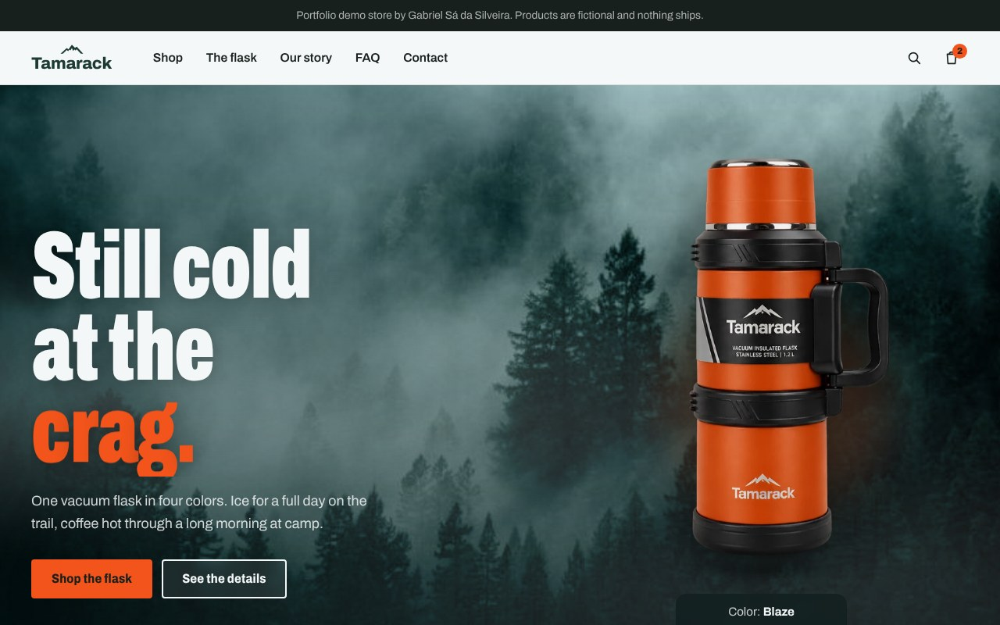
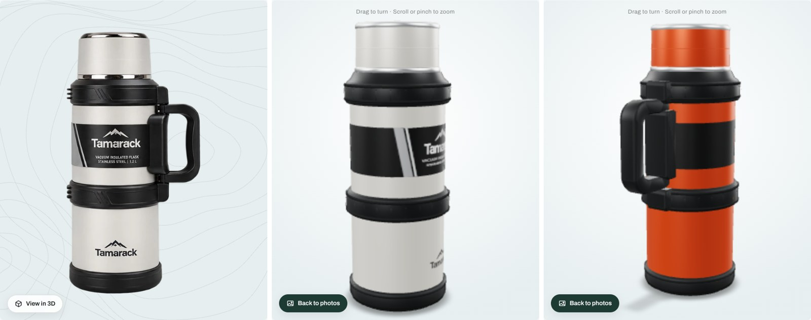
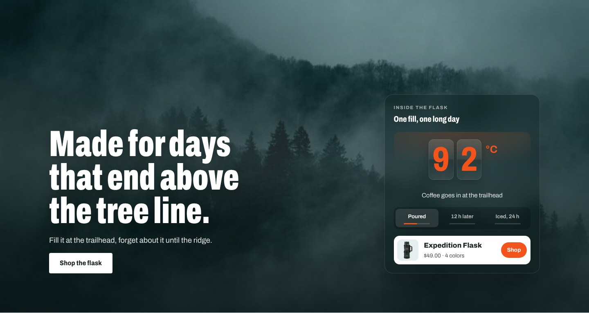
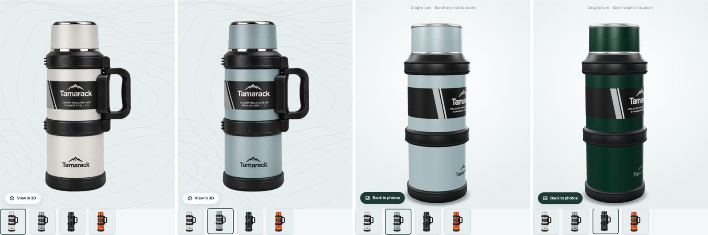
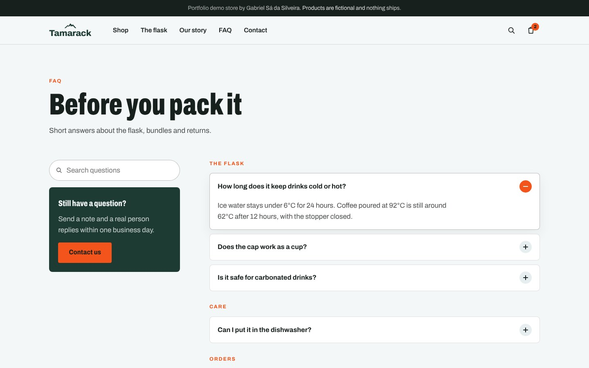

# Tamarack: a Shopify OS 2.0 theme built from scratch

[](https://github.com/gabrielSallesSi/tamarack-shopify-theme/actions/workflows/theme-check.yml)

Tamarack is a portfolio theme for a fictional brand of insulated bottles. It was built with Liquid, CSS and vanilla JavaScript, without a starter theme or a front-end framework. Shopify Theme Check runs automatically in GitHub Actions on every pull request targeting `main` and every push to `main`.

**Live demo:** [tamarack-gtqamv8f.myshopify.com](https://tamarack-gtqamv8f.myshopify.com) (password: `tamarack`). It is a Shopify development store, so checkout only accepts test payments.



| | |
| --- | --- |
|  |  |
|  |  |

## What it shows

- **Photo or vector product imagery that switches color live.** Each color has its own photo (variant images, or theme assets for products tagged `asset-photos`); picking a swatch crossfades to it on the hero, product cards and product page. Products without photos fall back to SVG art tinted in the chosen color.
- **Hero** on a full-bleed photo of a dark pine forest in low fog, with a cold blue-green color grade and two layers of drifting fog; the photo settles in from a slow zoom and drifts with the cursor and scroll, plus a headline whose last word rotates, a product photo that floats gently over a glow in the selected color, a magnetic call to action and a temperature chart that draws itself and counts the temperatures.
- **Real Alpine photography in 4K** in the hero, a full-width photo break with parallax, the same cold grade and a glass temperature readout whose odometer digits roll between moments of the day, with a shortcut to the product, and behind the newsletter. Each spot takes an uploaded image or an Unsplash link from the theme editor and serves sizes up to 3840 px wide.
- **Magic bento grid** of features whose borders glow toward the cursor, under a shared spotlight, with gentle tilt, click ripples and counting numbers.
- **Scroll-driven story:** a marquee that speeds up and reverses with scroll velocity, a 3D card stack of the four colors you can flick through, and a product anatomy with hotspots and pop-up notes.
- **Product page:** a 3D viewer for products with 3D models in their media (Shopify's model-viewer, loaded only when the shopper opens it), which follows the selected color and offers "View in your space" augmented reality on supported phones; lens zoom on the photo, color swatches with name tooltips and click sparks, bundle tiers (1, 2 or 3) with an animated border on the featured tier and prices that roll to their new value, subscribe and save via selling plans, a sticky add-to-cart bar, and an add-to-cart button where a flask drops into the cart.
- **AJAX cart drawer** built on the Cart API and Section Rendering API, with a free shipping progress bar that fires confetti when the threshold is reached, line and cart-level discounts, an optional upsell and a bar loader while it updates.
- **Details:** decrypting spec values, a scroll progress bar under the header, a shining announcement bar, a send animation on the newsletter button, flowing trail lines behind the newsletter and a giant store name in the footer whose letters stretch toward the cursor (Archivo variable width and weight axes).
- Self-hosted variable font (Archivo, SIL OFL), accessible markup, visible focus states, and every animation respects `prefers-reduced-motion`. Heavy effects pause off screen.

## Structure

```
layout/      theme.liquid, password.liquid
sections/    hero, marquee, magic-bento, photo-break, color-swap, anatomy, spec-sheet, faq, newsletter,
             story, main-faq, main-contact, size-lineup, featured-collection, text-reveal,
             header and footer groups, cart-drawer, main-* templates
snippets/    nature-photo (responsive remote or uploaded photo), product-media, product-card, product-art (SVG),
             cart-line, cart-progress, retention-track, swatch, color-hex, price, icon, logo-mark, favicon
assets/      base.css, theme.js, cardswap.js, canvas-confetti.js,
             product photos (webp), favicon, Archivo variable woff2
templates/   JSON templates for every page type (including page.about, page.faq and page.contact), plus customers/*
docs/        screenshots used in this README (not part of the theme upload)
```

## Install

1. Download this repository as a ZIP, remove the `docs/` and `.github/` folders plus `README.md`, then zip the Shopify theme folders.
2. In Shopify admin, go to Online Store > Themes > Add theme > Upload zip file, then publish it.
3. Import products, tag the product with `asset-photos` and `insulated`, and create a `custom.capacity` product metafield.
4. Create pages using the `about`, `faq` and `contact` templates and add them to the main menu.
5. For bundle pricing, add two automatic "Amount off products" discounts: 10% with a minimum of 2 items, and 15% with a minimum of 3.

## Product setup

Tag a product with `asset-photos` to use the bundled photos (`tamarack-flask-<color>.webp`) when it has no variant images, with `insulated` to show the temperature track, and with `art-bottle`, `art-tumbler`, `art-jug`, `art-mug`, `art-lid`, `art-tin` or `art-sling` to choose a vector shape for products without photos. Color option values map to swatch colors in `snippets/color-hex.liquid`.

To add the 3D viewer, upload one `.glb` model per color to the product's media and include the color in the file name (`tamarack-flask-blaze.glb`) or in the media description (`Blaze`). The product page shows a "View in 3D" button when models are present, and the 3D view switches with the color swatches. It can be turned off in the Product section settings.

## Credits

Several effects are adapted from open component libraries and rewritten from React into vanilla JavaScript and CSS for Liquid:

| Effect in Tamarack | Source | License |
| --- | --- | --- |
| Feature grid (`sections/magic-bento.liquid`) | React Bits MagicBento by David Haz | MIT + Commons Clause, Copyright (c) 2026 David Haz |
| Color card stack (`assets/cardswap.js`) | [React Bits](https://reactbits.dev) CardSwap by David Haz | MIT + Commons Clause, Copyright (c) 2026 David Haz |
| Rotating headline word, blur-in headline | React Bits RotatingText, BlurText | same as above |
| Magnetic button | React Bits Magnet | same as above |
| Temperature count-up, decrypting specs | React Bits CountUp, DecryptedText | same as above |
| Shining announcement, featured tier border | React Bits ShinyText, StarBorder | same as above |
| Click sparks, product art spotlight | React Bits ClickSpark, SpotlightCard | same as above |
| Velocity marquee, giant footer word | React Bits ScrollVelocity, TextPressure | same as above |
| Rolling temperature readout on the photo break | React Bits Counter | same as above |
| Scroll text reveal, scroll progress, price ticker, lens zoom, shimmer button, confetti | [21st.dev](https://21st.dev) components from [Magic UI](https://magicui.design) | MIT, Copyright (c) Magic UI |
| Confetti engine (`assets/canvas-confetti.js`) | canvas-confetti by Kiril Vatev | ISC |
| Marquee section | 21st.dev Marquee from Kibo UI (haydenbleasel/kibo) | MIT |
| Newsletter trail lines | 21st.dev Background Paths from [Kokonut UI](https://kokonutui.com) | MIT, Copyright (c) 2025 kokonutUI |
| Add-to-cart animation | [Uiverse](https://uiverse.io) button by vinodjangid07 | MIT, Copyright (c) 2023 Uiverse.io |
| Swatch and hotspot pop-ups | Uiverse tooltip by vinodjangid07 | same as above |
| Newsletter send button | Uiverse button by adamgiebl | same as above |
| Cart loader | Uiverse loader by coding-masala | same as above |

Photos are from [Unsplash](https://unsplash.com) under the Unsplash License (free for commercial use): [foggy pine forest by Kyle Glenn](https://unsplash.com/photos/green-leafed-pine-trees-SrASYZZpyjw), [misty forest slope by Vivek Vg](https://unsplash.com/photos/a-foggy-forest-with-trees-on-the-side-of-a-hill-YSE2pR3FO9U), [foggy pine mountainside by Brice Cooper](https://unsplash.com/photos/yj4Jjl2sCL0) and [pines below a snowy peak](https://unsplash.com/photos/a-snow-covered-mountain-with-trees-in-the-foreground-9_UyMXBAVEg). They load from the Unsplash CDN; upload your own in the theme editor to replace them.

React Bits components are used here as part of a website theme; under their license they may not be sold or redistributed on their own.

Built by Gabriel Sá da Silveira.
